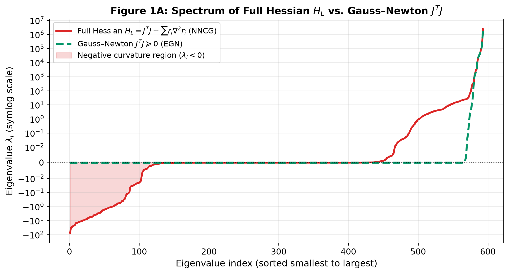
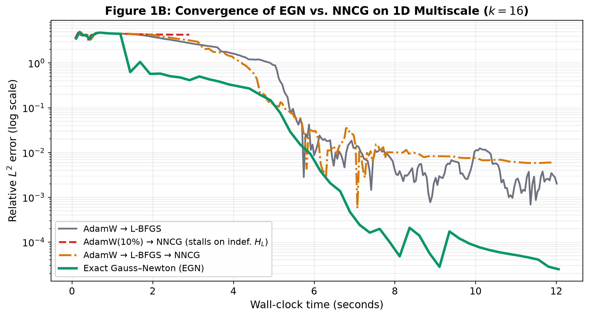
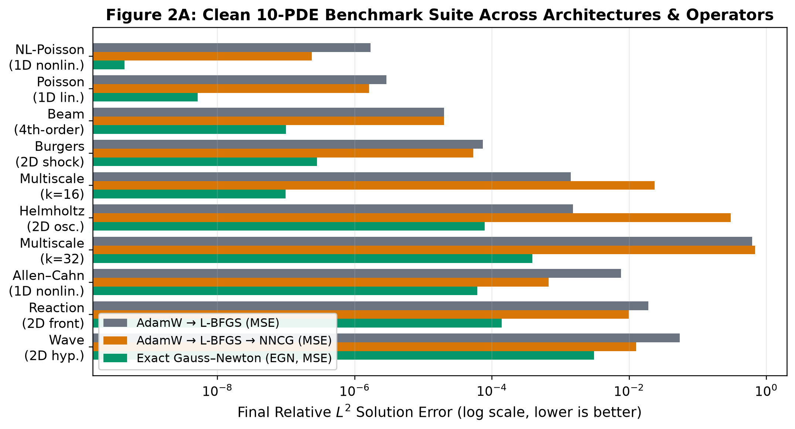
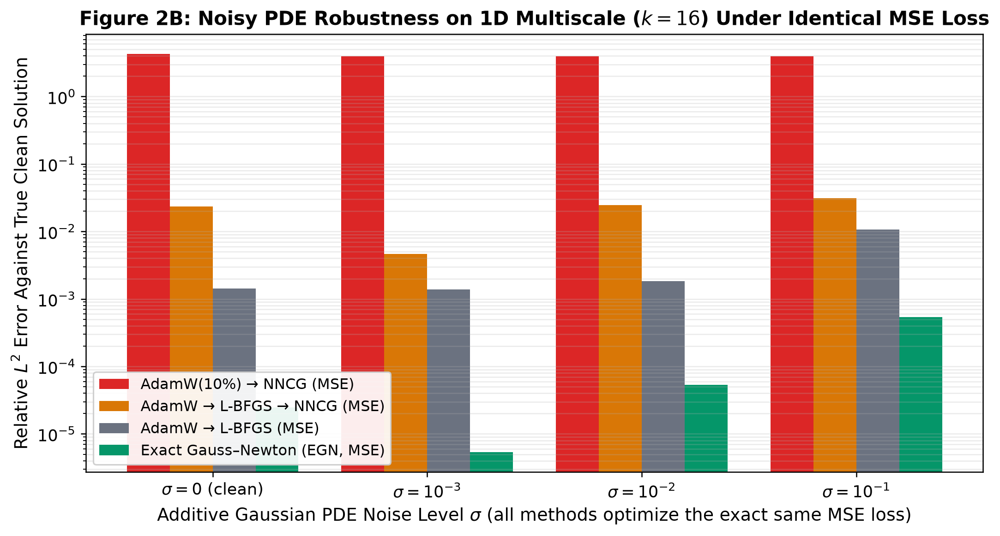

# Taming Ill-Conditioning in PINNs: Exact Second-Order Descent via Gauss–Newton

---

## 1. Conclusions of Rathore et al. (ICML 2024)

A Physics-Informed Neural Network (PINN) approximates an unknown PDE solution $u^*(x)$ with a neural network $u_\theta(x)$ ($\theta \in \mathbb{R}^D$) by minimizing the mean-squared PDE residual, boundary, and initial conditions across $N$ collocation points:

$$L(\theta) = \frac{1}{2}\|r(\theta)\|_2^2 = \frac{1}{2}\sum_{i=1}^N r_i(\theta)^2$$

Unlike supervised learning with noisy labels, forward PINNs are deterministic approximation tasks requiring $L(\theta) \to 0$ for physical fidelity. Rathore et al. (*Challenges in Training PINNs: A Loss Landscape Perspective*, ICML 2024) study why gradient methods struggle to achieve this precision and establish three primary takeaways:

1. **Differential operators induce severe loss landscape ill-conditioning:** Applying a differential operator $\mathcal{D}[u_\theta]$ (e.g., $\partial_{xx}$, $\partial_{xxxx}$, or $\partial_{tt} - c^2 \partial_{xx}$) amplifies high-frequency modes and stretches the eigenvalue spectrum of the loss Hessian $H_L(\theta) = \nabla^2 L(\theta)$ across $10^3\text{--}10^5+$ orders of magnitude, generating narrow, anisotropic canyons.
2. **First-order methods stall inside ill-conditioned canyons:** Near initialization, Adam navigates past non-convex saddle points into a promising basin, but its gradient is dominated by steep canyon walls, oscillating transversely and stalling at $10^{-2}\text{--}10^{-4}$ relative $L^2$ error.
3. **Second-order curvature scaling is required to restore isotropic descent:** Rescaling descent steps by inverse curvature compresses the stretched Hessian spectrum by $>10^3\times$. Because quasi-Newton `L-BFGS` relies on gradient history and stalls along narrow valleys, Rathore et al. introduce **NysNewton-CG (`NNCG`)**—solving $(H_L + \mu I) d = -\nabla L$ via Nyström-preconditioned Conjugate Gradient (CG) following an `Adam -> L-BFGS` warm-up.

---

## 2. Problems with `NNCG`

To understand why `NNCG` is both computationally demanding and fragile away from the minimizer, we examine the analytic Hessian of the least-squares objective $L(\theta) = \frac{1}{2}\|r(\theta)\|_2^2$:

$$H_L(\theta) = \underbrace{J(\theta)^T J(\theta)}_{\text{Gauss–Newton matrix } (\succeq 0)} + \underbrace{\sum_{i=1}^N r_i(\theta) \, \nabla^2 r_i(\theta)}_{\text{residual curvature (indefinite)}}, \qquad J(\theta) = \frac{\partial r}{\partial \theta} \in \mathbb{R}^{N \times D}$$

Operating directly on the full loss Hessian $H_L(\theta)$ introduces three structural deficiencies into `NNCG`:

1. **Indefiniteness violates descent and derails Conjugate Gradient:** Whenever $r(\theta) \neq 0$ (early in training or under measurement noise), the residual curvature term $\sum_{i=1}^N r_i \nabla^2 r_i(\theta)$ introduces negative eigenvalues into $H_L(\theta)$. Indefiniteness violates the descent condition $d^T \nabla L < 0$, directs Newton steps toward saddle points, and invalidates Conjugate Gradient (which strictly requires positive definiteness), necessitating thousands of first-order preconditioning steps.
2. **Dense rank-$D$ residual curvature prevents dual dimension reduction:** Because $\sum_{i=1}^N r_i \nabla^2 r_i(\theta)$ is a dense $D \times D$ operator of full rank, $H_L(\theta)$ cannot be reduced to the collocation dimension $N \times N$. Even when $N \ll D$, materializing $H_L(\theta)$ scales as $\mathcal{O}(D^2)$ memory and $\mathcal{O}(D)$ second-derivative passes, forcing `NNCG` to employ low-rank Krylov approximations.
3. **Second-derivative operator differentiation creates severe overhead:** Because $r(\theta)$ contains spatial derivatives, applying $H_L(\theta)$ in matrix-free CG requires evaluating second-derivative operator passes sequentially, yielding per-step runtimes orders of magnitude slower than first-order updates.

---

## 3. Exact Gauss–Newton (`EGN`) Algorithm

In language and vision models, parameter dimension $D$ ($10^8\text{--}10^{11}$) and dataset size $N$ ($10^6\text{--}10^{12}$) necessitate first-order methods. **Practical PINNs inhabit the opposite regime:** compact networks ($D \sim 5\text{k}\text{--}50\text{k}$) evaluated on moderate collocation sets ($N \sim 500\text{--}10{,}000$, frequently with $N < D$).

Crucially, in forward PINNs, driving the residual toward zero ($r(\theta^*) \to 0$) implies that **the loss Hessian asymptotically converges to the Gauss–Newton matrix:**

$$H_L(\theta) = J(\theta)^T J(\theta) + \sum_{i=1}^N r_i(\theta) \, \nabla^2 r_i(\theta) \;\xrightarrow{\|r(\theta)\|_2 \to 0}\; J(\theta)^T J(\theta)$$

By discarding the residual curvature $\sum_i r_i \nabla^2 r_i(\theta)$, the linear system $(J^T J + \mu I_D) d = -J^T r$ can be solved **identically in whichever dimension $\min(N, D)$ is smaller** via the push-through identity:

$$d = \underbrace{-(J^T J + \mu I_D)^{-1} J^T r}_{\text{Primal solve } (D \times D\text{, when } D \le N)} \;=\; \underbrace{-J^T (J J^T + \mu I_N)^{-1} r}_{\text{Dual solve } (N \times N\text{, when } N < D)}$$

Discarding the indefinite residual curvature yields three foundational mathematical properties:

1. **Zero approximation error at a clean PDE solution ($r(\theta^*) = 0$):** The gradient $\nabla L(\theta) = J(\theta)^T r(\theta)$ is exact, and as $r_i \to 0$, $\sum_i r_i \nabla^2 r_i(\theta) \to 0$ automatically, so **$J^T J$ equals the exact Hessian $H_L$ at the solution**.
2. **Immunity to saddle points and noise away from $r = 0$:** When $r_i \neq 0$ (early in training or under additive noise $\epsilon_i$), $\sum_i r_i \nabla^2 r_i$ injects negative eigenvalues into $H_L$ that force `NNCG` to add heavy damping $\mu$ or abort CG early. Because $J^T J \succeq 0$ does not depend on $r_i$, every `EGN` step points strictly downhill from random initialization.
3. **Exact full-rank Cholesky in $\min(N, D)$ vs. low-rank CG approximation:** `NNCG` only approximates $(H_L + \mu I)^{-1}$ via a rank-60 Nyström preconditioner and iterative CG, whereas **`EGN`** directly factors the full $\min(N, D) \times \min(N, D)$ matrix via Cholesky, inverting *all* curvature directions simultaneously using only first derivatives of $r(\theta)$.

---

## 4. Experimental Results

We benchmark **`EGN`** against Rathore et al.'s **`NNCG`** (both following a 10% AdamW warm-up and within a 3-stage `AdamW -> L-BFGS -> NNCG` pipeline) and **`AdamW -> L-BFGS`** across 10 clean and Gaussian-noisy PDEs on 3-layer width-50 $\tanh$ MLPs ($D \approx 5{,}250$, $N \approx 514\text{--}2{,}180$) in `float64`, with all methods optimizing the identical MSE loss.

**Table 1: Head-to-head comparison of relative $L^2$ error, final MSE loss $L(\theta)$, and step time across clean and noisy PDEs.**

| PDE Problem | Regime / Challenge | `AdamW -> L-BFGS` | `AdamW(10%) -> NNCG` | `AdamW -> L-BFGS -> NNCG` | **Exact Gauss–Newton (`EGN`)** |
| :--- | :--- | :---: | :---: | :---: | :---: |
| **Poisson** | 1D linear ($-u'' = f$) | $2.92 \times 10^{-6}$ ($L=7.7\text{e-}7$) | $2.19 \times 10^{-6}$ (93 ms) | $1.63 \times 10^{-6}$ ($L=1.2\text{e-}7$, 92 ms) | **$5.16 \times 10^{-9}$** (**$L=4.0\text{e-}13$**, 88 ms) |
| **Nonlinear Poisson** | 1D nonlinear ($-u'' + u^3 = f$) | $1.72 \times 10^{-6}$ ($L=1.7\text{e-}7$) | $4.31 \times 10^{-6}$ (142 ms) | $2.39 \times 10^{-7}$ ($L=1.2\text{e-}8$, 75 ms) | **$4.42 \times 10^{-10}$** (**$L=1.8\text{e-}14$**, 103 ms) |
| **Beam** | 1D 4th-order ($u^{(4)} = f$, $\kappa > 10^{10}$) | $2.01 \times 10^{-5}$ ($L=7.8\text{e-}6$) | $1.88$ (*indef. $H_L$*) | $2.02 \times 10^{-5}$ ($L=6.1\text{e-}6$, 760 ms) | **$9.98 \times 10^{-8}$** (**$L=4.7\text{e-}7$**, 406 ms) |
| **Multiscale ($k=16$)** | 1D high-freq ($\sin 16\pi x$) | $1.42 \times 10^{-3}$ ($L=4.6\text{e-}4$) | $4.26$ (*indef. $H_L$*) | $2.36 \times 10^{-2}$ ($L=9.2\text{e-}2$, 610 ms) | **$9.90 \times 10^{-8}$** (**$L=7.6\text{e-}7$**, **89 ms**) |
| **Helmholtz** | 2D oscillatory ($-\Delta u - k^2 u = f$) | $1.53 \times 10^{-3}$ ($L=5.9\text{e-}6$) | $18.6$ (*indef. $H_L$*) | $3.04 \times 10^{-1}$ ($L=1.2\text{e-}1$, 870 ms) | **$7.84 \times 10^{-5}$** (**$L=2.4\text{e-}8$**, **185 ms**) |
| **Burgers** | 2D nonlinear shock ($u_t + u u_x = \nu u_{xx}$) | $7.44 \times 10^{-5}$ ($L=3.1\text{e-}8$) | $1.10 \times 10^{-2}$ (448 ms) | $5.40 \times 10^{-5}$ ($L=3.2\text{e-}8$, 337 ms) | **$2.82 \times 10^{-7}$** (**$L=8.3\text{e-}13$**, 655 ms) |
| **Reaction ($\rho=5$)** | 2D nonlinear front ($u_t = \rho u(1-u)$) | $1.92 \times 10^{-2}$ ($L=4.5\text{e-}6$) | — | $9.92 \times 10^{-3}$ ($L=1.4\text{e-}6$, 720 ms) | **$1.40 \times 10^{-4}$** (**$L=3.3\text{e-}11$**, **328 ms**) |
| **Wave ($\beta=5$)** | 2D hyperbolic ($u_{tt} - c^2 u_{xx} = 0$) | $5.52 \times 10^{-2}$ ($L=8.9\text{e-}5$) | — | $1.27 \times 10^{-2}$ ($L=1.4\text{e-}5$, 29,000 ms) | **$3.08 \times 10^{-3}$** (**$L=2.8\text{e-}5$**, **656 ms**) |
| **Multiscale + Noise** | Gaussian PDE noise ($\sigma = 10^{-3}$) | $1.38 \times 10^{-3}$ | $3.96$ (*indef. $H_L$*) | $4.63 \times 10^{-3}$ (548 ms) | **$5.37 \times 10^{-6}$** (**$860\times$ lower vs. `NNCG`**) |
| **Multiscale + Noise** | Gaussian PDE noise ($\sigma = 10^{-2}$) | $1.84 \times 10^{-3}$ | $3.97$ (*indef. $H_L$*) | $2.46 \times 10^{-2}$ (631 ms) | **$5.36 \times 10^{-5}$** (**$460\times$ lower vs. `NNCG`**) |
| **NL-Poisson + Noise** | Gaussian PDE noise ($\sigma = 10^{-2}$) | $7.15 \times 10^{-5}$ | $7.19 \times 10^{-5}$ (139 ms) | $7.21 \times 10^{-5}$ (140 ms) | **$5.14 \times 10^{-5}$** (**104 ms/step, lowest error**) |

**Three primary conclusions follow from the empirical results:**

1. **`EGN` achieves $10^2\times$ to $10^6\times$ lower loss and $4\times$ to $10^5\times$ lower $L^2$ error across benchmark PDEs:** Even when `NNCG` is initialized with a converged `AdamW -> L-BFGS` solution, **`EGN`** attains $540\times$ lower error on Nonlinear Poisson ($4.4 \times 10^{-10}$ vs. $2.4 \times 10^{-7}$), $200\times$ lower on 4th-order Beam, $190\times$ lower on 2D Burgers ($2.8 \times 10^{-7}$ vs. $5.4 \times 10^{-5}$), $71\times$ lower on 2D Reaction, and $2.4 \times 10^5\times$ lower on Multiscale ($k=16$).
2. **`EGN` reduces per-step computational overhead by avoiding sequential operator differentiation:** Because batched Jacobian evaluations compute $J$ in a single autodiff pass and dual Cholesky factorizes $\min(N, D)$, **`EGN`** achieves 89 ms/step on Multiscale ($6.8\times$ faster than `NNCG`) and 656 ms/step on Wave ($44\times$ faster than `NNCG`'s 29.0 s/step).
3. **`EGN` exhibits noise robustness under identical MSE objectives (Figure 2B):** When additive Gaussian noise $\epsilon_i \sim \mathcal{N}(0, \sigma^2)$ corrupts the PDE residual, the optimal residual remains nonzero ($r_i(\theta^*) \approx \epsilon_i \neq 0$), causing $\sum r_i \nabla^2 r_i(\theta)$ to inject indefinite curvature into $H_L$ at the minimizer. Because **`EGN`** evaluates curvature via $J^T J \succeq 0$, it converges stably to the $\mathcal{O}(\sigma)$ noise floor ($860\times$ lower error at $\sigma = 10^{-3}$ and $460\times$ lower at $\sigma = 10^{-2}$).
