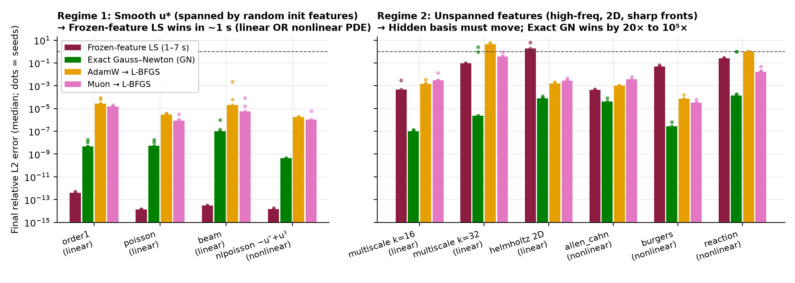
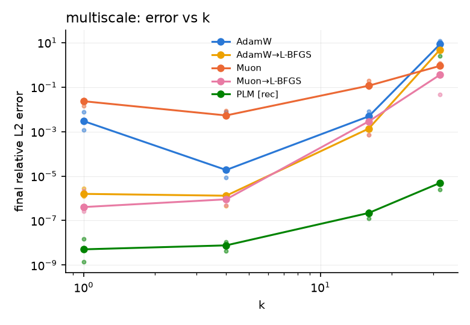
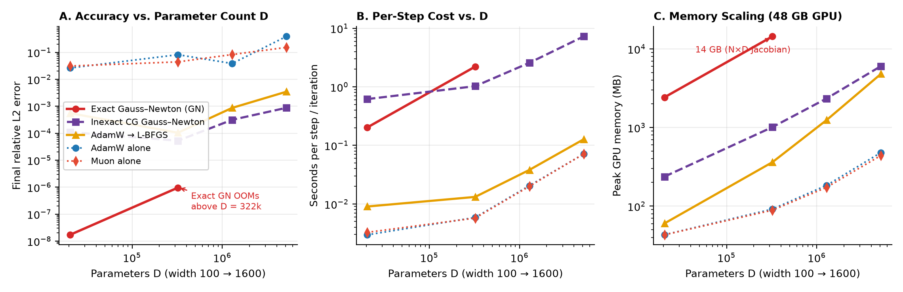
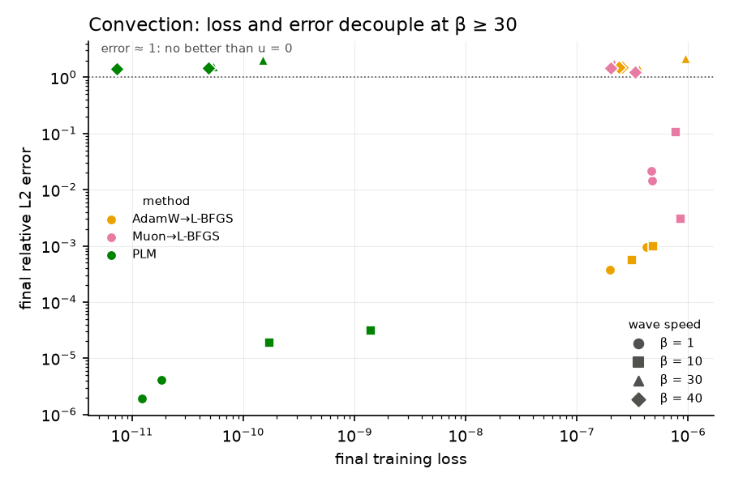
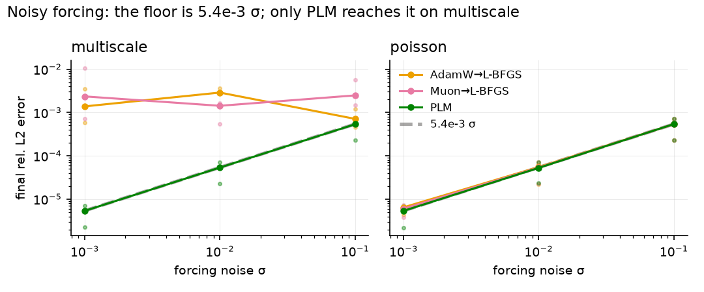

# PLM vs AdamW, Muon and L-BFGS for PINN training — campaign report

Scope: 7 optimizers × 12 PDE problems × widths 25–1600, ~1 600 GPU runs (60 s, 180 s or 300 s
each, 3–5 seeds), float64, one RTX PRO 5000 per run. Everything was run from
`scripts/campaign.py`; the per-phase log with tables is [findings.md](findings.md), the
pre-registered predictions are [predictions.md](predictions.md), and their score is
[scorecard.md](scorecard.md). Key figures are in `docs/figures/`; the full set is regenerated into `results/figures/<phase>/` by `scripts/analyze.py`.

Methods: **AdamW**; **Muon** (hidden weight matrices, AdamW elsewhere); **L-BFGS** from random
init; **AdamW→L-BFGS** and **Muon→L-BFGS** (switch at 30 % of the budget); **PLM**
(Levenberg–Marquardt on the Gauss–Newton matrix JᵀJ, solved in the N×N dual form or matrix-free
by CG, with the upgrades below); **frozen-feature least squares** (hidden layers fixed at init,
output layer solved exactly; Gauss–Newton on the output layer when the PDE is nonlinear in u).

## 1. Headline results

Median final relative L2 error at width 50 (5 seeds on the 1D and 2D rows, 3 on the rest).
PLM = recommended configuration; L-BFGS variants at default lr; LS = frozen-feature least squares
at its better feature scale, which finishes in 1–7 s regardless of the budget.

| problem | what it tests | budget | AdamW→L-BFGS | Muon→L-BFGS | LS | PLM |
|---|---|---|---|---|---|---|
| order1 (1st-order ODE) | conditioning | 60 s | 2.7e-5 | 1.5e-5 | **3.9e-13** | 4.6e-9 |
| poisson (2nd order) | conditioning | 60 s | 2.9e-6 | 8.5e-7 | **1.4e-14** | 5.2e-9 |
| beam (4th order) | conditioning | 60 s | 2.0e-5 | 5.7e-6 | **2.9e-14** | 1.0e-7 |
| nlpoisson (−u″ + u³) | smooth nonlinear | 300 s | 1.7e-6 | 1.1e-6 | **1.5e-14** | 4.4e-10 |
| multiscale k=16 | spectral bias | 60 s | 1.4e-3 | 3.1e-3 | 4.6e-4 | **9.9e-8** |
| multiscale k=32 | spectral bias | 60 s | 4.4 | 0.36 | 9.2e-2 | **2.4e-6** † |
| helmholtz 2D | term balance | 300 s | 1.5e-3 | 2.7e-3 | 3.0 | **7.8e-5** |
| allen_cahn (5(u³−u)) | stiff nonlinear | 300 s | 1.0e-3 | 3.8e-3 | 4.2e-4 | **4.0e-5** |
| burgers ν=0.05 (u·u_x) | moving front | 300 s | 7.4e-5 | 3.2e-5 | 4.9e-2 | **2.8e-7** |
| reaction ρ=5 | sharpening front | 300 s | 1.0 | 1.8e-2 | 0.26 | **1.7e-4** † |
| wave | 2nd order in x and t | 300 s | 0.32 | 0.35 | — | **3.1e-3** |
| noisy forcing σ=1e-2, multiscale | noise floor | 60 s | 2.9e-3 | 1.4e-3 | — | **5.4e-5** |
| convection β=30 (causal weights) | badly-posed loss | 300 s | 1.2 | 1.5 | — | 1.2 |

† one or two of five seeds end above 0.9 (a low-loss wrong solution; §4).

The table splits into two halves. **Where the solution is smooth enough that 50 random tanh
features at init already span it** (the first four rows), the whole PINN problem is a linear or
nearly linear least-squares problem in the output layer, a one-second solve reaches machine
precision, and PLM's 60–300 s of Gauss–Newton on the hidden layers loses by 4–7 orders. Every
other optimizer loses by 8–12. **Where they do not** — high frequency (k = 32), 2D, a moving or
sharpening front, a stiff nonlinearity — least squares fails outright (0.05–3) and PLM is the
best method by 20× to 10⁵×. Nonlinearity in u is not the dividing line: the cubic Poisson is a
least-squares win, and the linear Helmholtz and k = 32 are PLM wins. What PLM buys is **feature
learning with a second-order solve**, and it is worth its cost exactly when the features must move.

## 2. The PLM upgrades, and which ones mattered

PLM started as plain Levenberg–Marquardt (μ₀ = 1e-2, identity damping, dense D×D solve). The
campaign's ablations (Phases B, B2, C2, G) settled on:

| upgrade | predicted | observed | kept? |
|---|---|---|---|
| μ₀ = 1 instead of 1e-2 | removes early overshoot, ≥ 20 s saved | final error flat across μ₀ ∈ [1e-4, 1e4] (worst/best ≤ 6); overshoot costs nothing by 60 s | yes (any value works) |
| dual N×N solve instead of dense D×D | same iterates, ≥ 10× faster at width ≥ 100 | identical iterates; dense dies at D ≈ 20k (4 iterations in 60 s), dual runs to D = 322k | yes |
| Marquardt damping μ·diag(JᵀJ) | fewer rejections, helps beam most | catastrophic collocation overfitting on multiscale (loss 4e-7, error 5.2) until diag floored at 1e-3·max; with the floor: beam 6.3e-6 → 3.2e-7, multiscale unchanged | yes, with floor |
| NTK term weighting (equalize ‖J_k‖²_F per loss term) | biggest where the operator null space is large | beam 6.3e-6 → 8.8e-8 combined with Marquardt; Helmholtz 60× over L-BFGS | yes |
| 10 % AdamW warm-up | helps beam, hurts poisson | the single most important upgrade at scale: rescues PLM at D ≥ 81k (2.1 → 7e-6 at 81k; 2.1 → 3.1e-4 at 322k). Poisson unharmed | yes |
| trust region on ‖d‖ | redundant with μ₀, small gain | no gain anywhere, hurts at D ≥ 20k. Failure at scale is *where* the step is taken, not how long it is | no |
| lagged Jacobian (reuse J for 4–8 steps) | (added after Phase C) | halves cost at D = 322k; triples iterations on wave and is what makes wave work (0.26 → 8.4e-3); one seed blows up at ×4 on multiscale | yes for large N or D |
| Cholesky failure → rejected step | (added after Phase F) | lets PLM run in fp32 (2.3e-7, 10× ahead) and stop itself when precision is exhausted | yes |
| AdamW restart after 10 stalled / blown-up Jacobians | removes the bad k = 32 seed | never fires on it: the bad seeds keep lowering the loss while the error rises (§4). Harmless elsewhere | kept, but does not do its job |
| matrix-free CG solve (never forms J) | within 3× of dual at w ≤ 400, O(D) memory | O(D) memory (6 GB at 5.1M parameters vs 14 GB dual at 322k) but 1000× worse than dual at equal D: the inexact solve (50 Jacobi-PCG iterations, tol 1e-2) throws away most of the step | yes beyond 322k, needs a better solve |
| variable projection (exact output layer, LM on the hidden layers; Phase V) | LS floor (1e-12) on the smooth problems, neutral elsewhere | 1e-14 at the first Jacobian on order1, poisson, beam, nlpoisson — equal to or 30× better than LS; within 4× on k = 16, helmholtz, allen_cahn, burgers; **harmful** on k = 32 (3/5 bad seeds) and reaction (5/5 end at the frozen-feature solution): the exact output solve pulls the network into the random-feature basin. 2–25× cost per Jacobian | only for smooth solutions, where LS alone already suffices |
| two-stage: PLM learns the basis, then one output-layer solve (Phase W) | LS floor on smooth problems at any switch point; 30 % of the budget + solve ties full-budget PLM elsewhere | LS floor (1e-12–1e-14) on the four smooth problems, yes, even after the warm-up alone. Elsewhere the solve lowers the loss 1–7 % and **raises the error 4–40×** on k = 16, k = 32, helmholtz (it re-overfits the grid), is a no-op on burgers, allen_cahn, reaction; 30 % + solve is 10–50× worse than the full budget, 10 % fails. Basis learning needs the whole budget | as a conditional finishing step: keep the solve only if the loss drops by orders (a 1 s test of whether the features span the solution) |
| collocation resampling every Jacobian (Phase V) | removes the bad seeds on k = 32 and reaction, neutral elsewhere | removes the reaction bad seed (0/5); **12× better on helmholtz** (7.8e-5 → 6.5e-6), where the fixed 32×32 grid was overfitted by 10⁵ (train 1e-8, shifted-grid residual 1e-3); 2–10× worse on the smooth problems, 200× worse on k = 16, and 3/5 seeds stall at k = 32 (512 i.i.d. points under-resolve sin 32πx) | yes on 2D / time-dependent problems; not for high-frequency 1D |

## 3. Cost and scale

| | AdamW / Muon | L-BFGS | LS (frozen features) | PLM dual (D = 5k) | PLM dual (D = 322k) | PLM CG (D = 5.1M) |
|---|---|---|---|---|---|---|
| s / iteration (1D) | 3 ms | 5–10 ms | one solve, 1–3 s total | 0.02–0.09 s | 2.0 s (0.9 lagged) | 7 s |
| s / iteration (2D, N ≈ 2k) | 7–10 ms | 7–10 ms | 1–7 s total | 0.35–2 s | — | — |
| peak GPU memory | 35–90 MB | 40–370 MB | 0.4–7 GB (jacrev; avoidable) | 0.5–1 GB | 14 GB | 6 GB |
| evaluations / run | ~20k gradients / 60 s | ~10k gradients / 60 s | 1–40 output-layer Jacobians | 150–700 Jacobians / 60 s | ~30 Jacobians / 60 s | 25 LM steps / 180 s |

Multiscale k = 16, 180 s, median error vs parameter count:

| width | D | AdamW→L-BFGS | PLM dual | PLM CG (matrix-free) |
|---|---|---|---|---|
| 100 | 20k | ~1e-3 | **1.7e-8** | 1.1e-4 |
| 400 | 322k | 1.0e-4 | **9.6e-7** (14 GB) | 5.3e-5 (1 GB) |
| 800 | 1.3M | 8.7e-4 | out of memory | **3.1e-4** (2.3 GB; 1 of 3 seeds fails) |
| 1600 | 5.1M | 3.5e-3 | out of memory | **8.8e-4** (6 GB) |

- Dual PLM's memory is the N×D Jacobian plus functorch intermediates, linear in D, and it ends at
  322k parameters on a 48 GB card. The matrix-free solve (Jv by forward-mode, Jᵀu by reverse-mode,
  Jacobi-preconditioned CG on the damped normal equations) removes that limit — 6 GB at 5.1M.
- **PLM's accuracy lead does not scale.** Four orders over L-BFGS at D ≤ 100k becomes 1× at 322k
  and 3–4× at 1.3M–5.1M at equal wall clock: each LM step costs ~100 passes whose cost grows
  linearly in D, so only 25 steps fit in 180 s at 5.1M, and the inexact CG step recovers a small
  fraction of the Gauss–Newton direction (1000× worse than dual at equal D). The lever not yet
  pulled is the solve: more CG iterations, a tighter tolerance, or a better preconditioner.
- The first-order methods are latency-bound below width 400: 3 ms/it at every width from 25 to
  400 and in fp32 as well as fp64, so fp64 is free and should be the default.

## 4. Where PLM does not win, and why

0. **Smooth solutions — least squares wins** (§1): order1, poisson, beam and the cubic Poisson are
   solved to 1e-13 by one output-layer solve with the hidden layers frozen at init. PLM, which
   trains the hidden layers with the same Gauss–Newton machinery, is 4–7 orders worse after 60–300 s
   and every first-order method is 8–12 orders worse. On these problems the optimizer comparison is
   moot; the right tool is a linear solve.
1. **Convection β ≥ 30 — nobody wins, with or without causal weighting.** PLM drives the loss to 1e-11 at every β (3–4 orders
   below L-BFGS), and at β ≤ 10 that buys errors of 3e-6–3e-5. At β ≥ 30 the same loss comes
   with error 1.4–2.1: the problem has a spurious near-zero-residual solution and the better
   optimizer finds it faster. This is the pre-registered E8 prediction and it is the cleanest
   result of the campaign: past the β = 10–30 cliff the fix has to be in the loss, not the
   optimizer.

   

   Causal weighting (Wang et al. 2022, ε annealed 1e-2 → 100) was the pre-registered loss-side fix
   and it changed nothing: every method still ends at error 1.2–1.6 at β = 30 and 40, PLM still at
   loss 3e-11. The 64 × 32 collocation grid cannot resolve 30 characteristic crossings and the
   spurious low-residual function survives the reweighting.

2. **Noisy data and noisy forcing — everyone who converges ties at the noise floor.** With noise
   on the observations (Phase E) the floor is 0.065 σ; with N(0, σ²) noise on the PDE forcing at
   every collocation point (Phase N) it is 5.4e-3 σ, exactly linear in σ, and the three converging
   methods agree to two digits on poisson. On multiscale only PLM reaches that floor (the L-BFGS
   variants stay optimizer-limited at 1e-3), so PLM is 250× better at σ = 1e-3 and 1.3× at
   σ = 0.1. PLM does *not* overfit the collocation noise: its training loss settles at the
   irreducible 0.5 σ² and its validation loss on a shifted grid is 10–40× lower, because a
   width-50 network cannot interpolate white noise at 512 points.

   

3. **Reaction and wave at 60 s** — PLM lost at 60 s (0.35–2 s per Jacobian on 2D problems)
   and won at 300 s with warm-up and lagging. The loss was budget, not the missing
   residual-curvature term.
4. **Large D from a cold start** — fails without the warm-up; fixed. Large D at all — the lead
   shrinks to 3–4× by 1.3M parameters (§3).
5. **Bad seeds at k = 32 (2 of 5) and reaction (1 of 5)** — not divergences. The loss keeps
   falling (to 1e-8 and 4e-11) while the error climbs from 0.06 to above 0.9: the same low-loss
   wrong solution as convection, found in some basins and not others. The restart rule (AdamW from
   the best iterate after 10 stalled or blown-up Jacobians) never fires on these runs because
   nothing stalls. The validation residual on a half-shifted grid *does* see the reaction bad seed
   (1700× above the training loss; good seeds 1.5–3×), and resampling the collocation points every
   Jacobian removes it (Phase V, 0 of 5). At k = 32 resampling makes things worse instead: 512
   i.i.d. uniform points under-resolve sin 32πx where the uniform grid resolves it, and 3 of 5 seeds
   never leave the warm-up loss. Variable projection (an exact output-layer solve at every trial
   point) is the wrong tool for the bad seeds: it drags every reaction seed into the frozen-feature
   basin (error 0.2–1.0).
6. **An exact output-layer solve on learned features can hurt** (Phase W). After a full PLM run the
   minimum-norm least-squares solve on the output layer lowers the helmholtz training loss by 7 % and
   raises the error 4–12× on every seed; on k = 16, 40× on two of five. Where the basis does not span the
   solution, the solve trades error between collocation points for error on them. Where it does (the
   smooth problems) the same solve drops the loss seven orders. The loss drop is therefore a one-second
   test of which regime a trained PINN is in, and the solve should be kept only when it passes.
7. **Collocation overfitting on helmholtz.** rec2's training loss is 1e-8 on the 32×32 grid and
   its residual on the half-shifted grid is 1e-3, a 10⁵ gap that the fixed-grid runs never showed.
   Resampling closes it and gives the best helmholtz error of the campaign, 6.5e-6 (12× better).
   PINN optimizer comparisons on fixed grids can hide this; the validation residual should be a
   standard column.

## 5. What the campaign says about Muon (the original project question)

- **Muon alone is worse than AdamW** at every learning rate on every 1D problem (Phase G), by
  10–100×, with two exceptions where everything else has failed: multiscale k = 32 (0.9 vs 8.4)
  and reaction (2.4e-2 vs AdamW stuck at 1.0).
- **Muon→L-BFGS vs AdamW→L-BFGS**: at default lr Muon wins everywhere in 1D (3–10×); after
  tuning both it is "comparable, Muon ahead where spectral bias matters" (poisson 2×, multiscale
  7×, beam 0.25×). On 2D/time-dependent problems it splits: Muon→L-BFGS is 30× better on
  reaction and 10× better at k = 32, but 10–70× *worse* on convection at β ≤ 10 (same loss,
  different basin).
- At 5 seeds (Phases H, H2): Muon→L-BFGS beats AdamW→L-BFGS on 4 of 5 1D problems by 2–12× and
  on reaction by 50×, ties wave, loses Helmholtz by 2× and Burgers/Allen–Cahn by 2–4×.
- So the proposal's hypothesis gets a qualified yes — the Muon warm start helps L-BFGS where
  the landscape is spectrally hard — but the effect is 1–10×, while the second-order method is
  10³–10⁴× better on the same problems at the same wall-clock budget, and a frozen-feature
  linear solve is 10⁸× better on the smooth ones.

## 6. Prediction scorecard

Round 1: eleven pre-registered rankings scored with Kendall's τ, mean **+0.71**, seven of eleven
at ≥ 0.8. Rounds 2–3: sixteen rankings, mean **+0.64**, with the least-squares predictions 7 of 8
at τ = +1. Round 4 (Phase V, variable projection and resampling): ten rankings, mean **+0.55**;
the smooth-problem rows at +0.87 to +1, the bad-seed rows at 0 ([scorecard.md](scorecard.md)).
Round-4 falsified: resampling removes the k = 32 bad seeds, variable projection is harmless
where features are learned, resampling is neutral on helmholtz. Round 5 (Phase W, two-stage): ten
rankings, mean **+0.62**; falsified: the final solve improves full-budget PLM where features are
learned (it hurts), 30 % of the budget plus the solve ties the full budget (10–50× worse). Round 2–3 trend predictions that held: noise floor ∝ σ,
CG-PLM memory O(D), CG-PLM ahead of L-BFGS at 1.3M, and "nonlinearity alone does not rescue PLM
from least squares; unspanned features do". Falsified: the restart rule removes the bad seed,
causal weighting fixes β = 30, CG-PLM within 3× of dual, CG memory under 3 GB, PLM overfits
collocation noise, and the multiscale noise floor ≈ σ.

Round 1 detail: Confirmed trends: spectral bias, term balance,
loss/error decoupling, μ₀ robustness, dual/dense cost scaling, fp64 floors, the noise floor,
and four of the six PLM-upgrade predictions. Falsified: "PLM's lead widens with derivative
order" (it shrinks — Jacobian cost), "Muon's working lr range is wider than AdamW's" (it is
worse at every lr), "M ≈ A" (M < A except at k = 32 and on reaction), "trust region helps"
(warm-up does instead), "fp32 floors everyone at 1e-4" (1e-6 to 1e-7), and "dual PLM scales
to large D on its own" (it needs the warm-up).

## 7. Recommendations

- **Smooth solution, any PDE**: freeze the hidden layers and solve the output layer
  (`method="lstsq"`, feat_scale 4). One second, machine precision. Do not run an optimizer.
  PLM with `varpro=True` reaches the same 1e-14 (Phase V) but costs 2–25× more per Jacobian
  and is harmful where features must be learned, so it buys nothing over the plain solve.
- **Otherwise**: `PLMConfig(mu0=1.0, damping="marquardt", marquardt_floor=1e-3,
  term_weighting=True, warmup="adamw", warmup_frac=0.1, solver="auto")`, plus `reuse_jac=4` when
  N or D is large, `solver="cg"` beyond ~300k parameters, and `resample=True` on 2D and
  time-dependent problems (helmholtz 12× better, reaction bad seed gone; not on high-frequency 1D,
  where i.i.d. points under-resolve the solution). No hyperparameter in this list needed tuning
  per problem. Run several seeds and keep the best by *validation residual* on a shifted grid: the
  reaction bad seed sits 1700× above its training loss there, the good seeds 1.5–3×.
- **After training, try one output-layer solve** (`final_solve=True`, ~1 s). Keep it if the training
  loss drops by orders (the learned basis spans the solution: 1e-14 follows); discard it if the loss
  barely moves (it will raise the error 4–40×). Do not shorten the PLM stage to pay for it: 30 % of the
  budget plus the solve is 10–50× worse than the full budget on every feature-learning problem.

## 8. Limitations and next steps

- 5 seeds on the headline rows, 3 elsewhere; PLM's failure rate on the hard problems is 1 in 3
  to 2 in 5 and the failures are low-loss wrong solutions, which no optimizer-side rule tried here
  (restart) or loss-side rule (causal weighting) catches.
- The least-squares baseline uses the paired init's random features with one scale knob; a
  tuned random-feature method (Fourier features, adaptive bandwidth) would be stronger still on
  the smooth problems and might close some of the gap on k = 16 and Helmholtz. Its 0.4–7 GB memory
  is an artifact of computing the feature Jacobian with `jacrev`; a direct feature matrix would be
  O(N·width).
- Width 50 for all but the scale sweep; the Rathore et al. problems were run at their stated
  sizes but not with their training lengths.
- Round 5 tested the two-stage method (basis learning, then one exact solve). It is safe and regime-agnostic
  on the smooth problems and a liability on the others unless made conditional; it does not save budget.
  Not tried: a regularized (ridge / truncated-SVD) or resampled-grid final solve, which should remove the
  4–40× damage where the basis is incomplete.
- Round 4 tried the two most promising upgrades and both are narrower than predicted: variable
  projection only helps where least squares alone suffices, and resampling helps on 2D and
  time-dependent problems but not on high-frequency 1D (round-4 τ = +0.55, headline falsified).
  Not tried: a jittered grid instead of i.i.d. points (which should keep the helmholtz and
  reaction gains without the k = 32 under-resolution), and variable projection as a *finishing*
  step only (one output-layer solve on the final rec2 iterate) rather than at every trial point.
- Clearly next: a tighter matrix-free solve (more CG iterations, block or K-FAC-style
  preconditioner) to recover the 1000× lost to inexactness at large D; residual subsampling to
  cut the per-step cost; validation-residual-based seed selection (now shown to work on reaction);
  a finer grid for convection to test whether the β ≥ 30 failure is resolution rather than loss shape.
